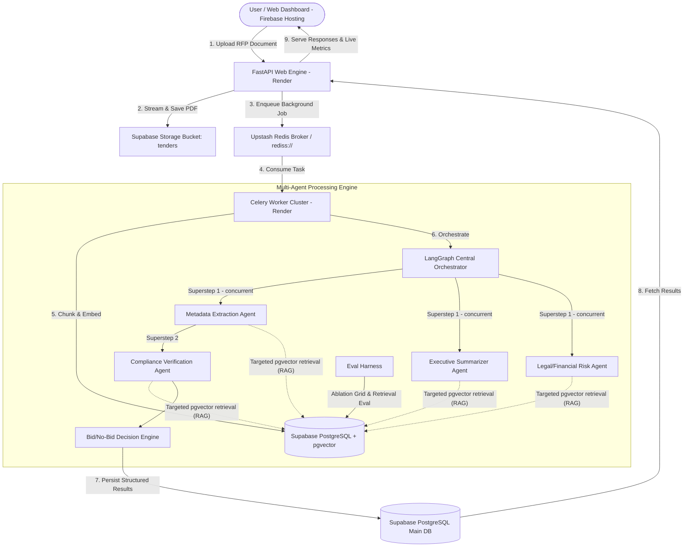

# TenderAI: Enterprise Multi-Agent Tender Analysis, Risk Evaluation & Compliance System
 
[](https://github.com/sharma614/Tender_AI/actions/workflows/ci.yml)
[](https://fastapi.tiangolo.com)
[](https://vitejs.dev)
[](https://python.org)
[](https://github.com/langchain-ai/langgraph)
[](https://ai.google.dev)
[](https://github.com/pgvector/pgvector)
[](https://render.com)
[](https://supabase.com)
[](https://upstash.com)
[](https://firebase.google.com)
[](LICENSE)
 
**TenderAI** reads a tender document (an RFP), pulls out key facts, flags legal and financial risks, checks eligibility against a company profile, and produces a bid / no-bid recommendation. Several LLM agents are coordinated by **LangGraph** and use **RAG over pgvector**; compliance checks run in Python. The repository includes deployment configurations for Render, Supabase, Upstash, Firebase Hosting, and AWS. These configurations describe deployment options; they do not mean the services are currently deployed or production-validated.
 
Historical evaluation numbers in this repository are exploratory and are not publication-ready. The archived four-arm ablation had failures in three arms; full-corpus repeated runs and confidence intervals are still required before making comparative accuracy or latency claims.
 
---
 
## 📑 Table of Contents
 
- [System Architecture](#-system-architecture)
- [Key Engineering Features](#-key-engineering--architectural-features)
- [Agent Roster](#-agent-roster)
- [Tech Stack](#-tech-stack)
- [Project Structure](#-project-structure)
- [Quick Start (Local Development, Zero Docker Required)](#-quick-start-local-development-zero-docker-required)
- [Environment Variables](#-environment-variables)
- [API Reference](#-api-reference)
- [Evaluation Harness & Empirical Benchmarks](#-evaluation-harness)
- [Bid Decision Engine](#-bid--no-bid-decision-engine)
- [Cloud Deployment Options](#-cloud-deployment-options)
- [AWS Cloud Infrastructure (Terraform Alternative)](#-aws-cloud-infrastructure-terraform-alternative)
- [Testing](#-testing)
- [License](#-license)
---
 
## 🏛️ System Architecture
 

 
The nine steps:
 
| Step | Component | What happens |
|:---:|:---|:---|
| 1 | User to FastAPI | The RFP PDF is uploaded with `POST /upload`. The API returns `202 Accepted` and a `job_id` right away. |
| 2 | FastAPI to Supabase Storage | The PDF goes into the `tenders` bucket, and its path is saved in `Tender.storage_path`. |
| 3 | FastAPI to Upstash Redis | The API dispatches a `process_tender_job` Celery task over a TLS Redis broker (`rediss://`). |
| 4 | Redis to Celery worker | A background worker on Render picks up the job. Failures are retried with exponential backoff. |
| 5 | Celery to pgvector | The PDF is extracted with PyMuPDF (OCR as fallback), chunked (1000/200), embedded (384 dimensions) and stored in Supabase pgvector. |
| 6 | Celery to LangGraph | The agent graph runs: Extraction, Summary and Risk concurrently, then Compliance, then Bid Decision. |
| 7 | Engine to PostgreSQL | Extracted facts, risk items, compliance checks and bid scores are committed to the database. |
| 8 | PostgreSQL to FastAPI | The client polls `GET /jobs/{job_id}` for the full evaluation state. |
| 9 | FastAPI to User | The dashboard shows the executive summary, compliance breakdown, risk ledger and bid verdict. |
 
---
 
## 🔑 Key Engineering & Architectural Features
 
### 1. Multi-agent pipeline vs. one big LLM call
 
`eval_harness.py` compares a monolithic baseline (`MonolithicAgent`) with the multi-agent RAG pipeline (`AgentOrchestrator`). The numbers below come from recorded runs in `eval_results/`.
 
| Metric | `mono-full` (monolithic baseline) | `multi-rag` / `multi-rag-cite` (TenderAI) |
|:---|:---:|:---:|
| **Context per agent call** | Full document text (~45k chars) | ~12k chars of retrieved chunks (about 12 chunks) |
| **Field accuracy** | Pending valid repeated rerun | Pending valid repeated rerun |
| **Tokens per document** | Pending valid repeated rerun | Pending valid repeated rerun |
| **End-to-end latency** | Pending valid repeated rerun | Pending valid repeated rerun |
| **Hallucination protection** | None. Output is unanchored, so "lost in the middle" errors are possible | Citations checked by substring containment |
| **Failure isolation** | A single failure breaks everything | Each agent fails on its own (Extraction, Summary, Risk, Compliance) |
 
**Evidence status:** the archived ablation artifact `eval_results/ablation-20261002T070644Z.json` contains only five documents, reports failures for three of four configurations, and cannot substantiate a four-way comparison. The older extraction artifact is a separate run and is not a substitute for the missing ablation arms. Do not cite the historical comparison as a result.
 
**Problem:** the issue with a single call over a dense tender is that models lose details buried in the middle of long documents, invent values, and take a long time to respond. **Solution:** TenderAI splits the job across agents. Each one gets the top-K chunks for its domain (at most 12 chunks: 3 per query, up to 5 queries), so the context is about 12k characters instead of 45k.
 
**Agent isolation design:** agents never hold a database session. Extraction, Summarization and Risk run as concurrent LangGraph nodes, and a SQLAlchemy Session shared across threads would corrupt state. Each agent returns a `ToolCallRecord` instead, and the orchestrator's `_persist` node writes them from a single thread once the graph finishes.
 
### 2. LangGraph orchestration (Pregel-style concurrency)
 
```
START ──┬──► [Extraction]  ──► (conditional) ──► [Compliance] ──► [Bid Decision] ──► END
        ├──► [Summarizer]  ──────────────────────────────────────────────────────► END
        └──► [Risk]        ──────────────────────────────────────────────────────► END
             ╰──── Superstep 1 (concurrent) ────╯
```
 
- **Superstep 1:** `extraction`, `summarizer` and `risk` fan out from `START` and run concurrently in LangGraph's Pregel loop.
- **Superstep 2:** `compliance` runs after `extraction`, since it needs `extracted_facts`.
- **Conditional routing:** if `extracted_facts is None`, compliance is skipped and the graph goes straight to `bid_decision`.
- The `tool_calls` field uses an `operator.add` reducer so records from concurrent agents merge safely.
### 3. Retrieval and citation verification
 
Chunking strategies:
 
| Strategy | Method | Chunk size | Overlap |
|:---|:---|:---:|:---:|
| **Character** (production default) | Sliding window | 1,000 chars | 200 chars |
| **Structure-aware** | Splits on section and clause headings | Variable, up to 1,500 chars | 150 chars (sub-chunks) |
 
Structure-aware chunking splits on headings like `SECTION X`, `CLAUSE Y.Z`, `ANNEXURE A` and `PART III` so clauses stay intact. It always emits a preamble section, which often holds the tender title and key dates.
 
Embeddings come from `sentence-transformers/all-MiniLM-L6-v2` (384-dimensional), stored as `VECTOR(384)` in PostgreSQL with an HNSW index.
 
Each agent has its own set of retrieval queries:
 
| Agent | Sample queries |
|:---|:---|
| **Extraction** | `"tender submission deadline closing date"`, `"earnest money deposit EMD bank guarantee"` |
| **Summarizer** | `"tender title overall scope of work"`, `"contract duration completion timeline"` |
| **Risk** | `"liquidated damages delay penalty clause"`, `"termination for convenience default clause"` |
 
**`rag-cite` mode:** in this mode, agents fill in `CitationRef` fields (`chunk_id`, `page_number`) for every extracted value. A `chunk_id` of `-1` means the agent couldn't attribute the value to any retrieved chunk. Citations are then checked by plain substring containment, with no LLM judge.
 
| Status | Meaning |
|:---|:---|
| `grounded` | The extracted value appears as a substring of the cited chunk. This confirms the value is present, not that the chunk supports it. |
| `ungrounded` | `chunk_id == -1`. The model admitted it had no source. |
| `hallucinated` | `chunk_id != -1`, but the value isn't in the cited chunk. |
| `missing_chunk` | The cited chunk ID doesn't exist in the database. |
 
A `grounded` result only means the string shows up somewhere in the chunk. A figure that appears as a counter-example, a historical value, or under a different field would still pass. So substring grounding is necessary but not sufficient. Stronger guarantees would need a semantic check, such as an LLM judge or an NLI model.
 
### 4. Deterministic compliance engine
 
LLMs are unreliable at questions like whether `$5,000,000` clears `Rs. 5 Crore`. They get magnitudes and unit conversions wrong. So compliance is checked in Python:
 
1. **Minimum Annual Turnover.** A monetary parser handles Crores, Lakhs, Millions, USD and INR (normalized at 83 INR/USD), then compares the numbers.
2. **Solvency Certificate.** A boolean presence check.
3. **Minimum Experience.** Years are pulled from the eligibility text with a regex and compared numerically.
4. **EMD Acknowledgment.** Presence only; compliant whenever it's acknowledged.
The LLM extracts the requirement strings, Python parses them into normalized floats, and Python does the comparison.
 
### 5. Bid / no-bid decision engine
 
```
CompositeScore = (ComplianceScore × 0.50) + (TechnicalFit × 0.30) + (max(0, 100 − RiskPenalty) × 0.20)
```
 
| Sub-score | Calculation |
|:---|:---|
| **`ComplianceScore`** | `(compliant + 0.5 × partial) / total × 100` |
| **`TechnicalFit`** | `50 + (matched_criteria / total_criteria × 50)`, so it ranges from 50 to 100 |
| **`RiskPenalty`** | `min(100, high×25 + medium×10 + low×3)` |
 
Rules are evaluated top to bottom, and the first match wins:
 
| Priority | Recommendation | Condition |
|:---:|:---|:---|
| 1 | ❌ `NO_BID` | Not overall compliant (a mandatory compliance failure) |
| 2 | ✅ `GO_BID` | Compliant AND CompositeScore ≥ 70 **AND** RiskPenalty **< 40** |
| 3 | ⚠️ `CONDITIONAL_BID` | Compliant and CompositeScore ≥ 45 (this includes score ≥ 70 with RiskPenalty ≥ 40) |
| 4 | ❌ `NO_BID` | CompositeScore < 45 |
 
**Note:** a score of 70 or more with a risk penalty of 40 or more does **not** give `GO_BID`. It falls through to `CONDITIONAL_BID`, because a strong financial fit shouldn't cancel out a heavy risk load.
 
Confidence (0.0 to 1.0):
 
```
Confidence = 0.30 × ExtractionCompleteness
           + 0.30 × GroundingRatio
           + 0.20 × ComplianceClarity
           + 0.20 × RiskDepth
```
 
### 6. Monolithic baseline and ablation
 
`MonolithicAgent` is a single-prompt control that processes the whole document in one call. The ablation harness runs four configurations on the same corpus:
 
| Config | Description |
|:---|:---|
| `mono-full` | Baseline: one LLM call, full document text |
| `multi-full` | Multi-agent, full-context prompts (no retrieval) |
| `multi-rag` | Multi-agent, retrieval-grounded prompts |
| `multi-rag-cite` | Full system: retrieval plus citation verification |
 
It measures macro field accuracy, total tokens (including billable reasoning tokens), estimated USD cost, latency, grounding precision and hallucination rate.
 
Token counts use `total_token_count` from the Gemini SDK, which includes billable "thinking" tokens. Adding up `prompt + completion` alone undercounts badly on gemini-3.x flash models.
 
### 7. Asynchronous job processing (Celery with Redis or SQS)
 
- **`POST /upload`** returns `202 Accepted` with a `job_id` in under 100 ms and never blocks the client.
- **Exponential backoff retry:** 30 s after attempt 1, 120 s after attempt 2, 480 s after attempt 3.
- **Dead-letter state machine:** after 3 retries the job is marked `dead_letter` and the error is stored in the database.
```
Job states: pending → processing → [retrying → ...] → completed | dead_letter
```
 
Two task entry points share the same `run_pipeline` function:
- `process_tender_job` for direct API uploads
- `process_tender_job_from_s3` for the Lambda to SQS path on AWS
### 8. Corrigendum / amendment support
 
TenderAI can process amendment documents that override fields on the parent tender:
 
```bash
# Applies corrigendum overrides to the parent tender (deadline, EMD, etc.)
orchestrator.apply_corrigendum(parent_tender_id, corrigendum_text, db)
```
 
The overridable fields are `submission_deadline`, `minimum_turnover` and `earnest_money_deposit_emd`. The code reassigns the whole dict instead of mutating it in place, because SQLAlchemy doesn't track in-place changes to JSON columns.
 
---
 
## 🤖 Agent Roster
 
| Agent | File | Responsibility | RAG queries |
|:---|:---|:---|:---:|
| **`ExtractionAgent`** | `app/agents/extraction.py` | Title, deadline, financial requirements, eligibility criteria | 5 |
| **`SummarizerAgent`** | `app/agents/summarizer_agent.py` | Executive summary, scope of work, key dates | 5 |
| **`RiskAgent`** | `app/agents/risk_agent.py` | Legal and financial risks with severity (Low/Medium/High) and mitigations | 6 |
| **`ComplianceAgent`** | `app/agents/compliance_agent.py` | Maps extracted facts to the company profile through the deterministic engine | none |
| **`MonolithicAgent`** | `app/agents/monolithic.py` | Control arm: every output in one LLM call | none |
| **`AgentOrchestrator`** | `app/agents/orchestrator.py` | Builds and runs the LangGraph `StateGraph` | none |
 
All agents extend `BaseAgent` (`app/agents/base.py`), which:
- configures the Gemini client once per process (`_configure_once`)
- enforces `response_mime_type="application/json"` for structured output
- times every LLM call (`latency_ms`) and reads token counts
- produces a `ToolCallRecord` on both success and failure
- clamps prompts at `MAX_PROMPT_CHARS = 1,500,000`
---
 
## 🛠️ Tech Stack
 
| Layer | Technology | Version / provider |
|:---|:---|:---|
| Language | Python | 3.11 / 3.12 |
| API framework | FastAPI + Uvicorn | ≥ 0.100 |
| Frontend | Vite SPA | ≥ 5.4 |
| UI and styling | Vanilla CSS design system | Responsive, glassmorphism |
| Data validation | Pydantic v2 | ≥ 2.0 |
| ORM | SQLAlchemy | ≥ 2.0 |
| DB migrations | Alembic | ≥ 1.13 |
| Database driver | psycopg v3 (`psycopg[binary]`) | ≥ 3.1.0 |
| LLM | Google Gemini (`gemini-3.6-flash`) | ≥ 0.7.0 |
| Agent orchestration | LangGraph | ≥ 0.2 |
| LLM toolkit | LangChain | ≥ 0.2 |
| Embeddings | sentence-transformers (`all-MiniLM-L6-v2`) | ≥ 3.0, < 4.0 (384-dim) |
| Vector search and relational DB | Supabase PostgreSQL + pgvector (HNSW), or local SQLite | Managed |
| Object storage | Supabase Storage (`tenders` bucket) | Managed, S3-compatible |
| Task queue | Celery | ≥ 5.3 |
| Message broker | Upstash Redis (TLS `rediss://`) or local Redis | Full asynchronous deployment |
| Application hosting | Render Web Service and Background Worker | Manual services; worker requires paid compute |
| Frontend hosting | Firebase Hosting | CDN |
| PDF processing | PyMuPDF (`fitz`) | ≥ 1.24 |
| OCR fallback | Tesseract + Pillow | |
| Alternative IaC | AWS Terraform (ECS Fargate, S3, SQS, RDS, VPC) | `infra/terraform/` |
| CI/CD | GitHub Actions | Lint, unit and integration tests |
| Testing | pytest + pytest-asyncio | |
 
---
 
## 📁 Project Structure
 
```
TenderAI/
├── app/
│   ├── agents/
│   │   ├── base.py               # BaseAgent: Gemini client, instrumentation, ToolCallRecord
│   │   ├── orchestrator.py       # LangGraph StateGraph + RAG retrieval + persistence
│   │   ├── extraction.py         # ExtractionAgent: title, deadline, financial, eligibility
│   │   ├── summarizer_agent.py   # SummarizerAgent: executive summary, scope, dates
│   │   ├── risk_agent.py         # RiskAgent: legal/financial risks, severity, mitigations
│   │   ├── compliance_agent.py   # ComplianceAgent: maps facts to company profile
│   │   └── monolithic.py         # MonolithicAgent: single-call baseline
│   ├── services/
│   │   ├── pdf_processor.py      # PyMuPDF extraction, OCR fallback, chunking strategies
│   │   ├── embedder.py           # sentence-transformers TextEmbedder (384d)
│   │   ├── retriever.py          # pgvector / SQLite cosine retrieval
│   │   ├── bid_decision_engine.py # Composite score, recommendation, calibrated confidence
│   │   ├── compliance_engine.py  # Deterministic numeric compliance checks
│   │   └── citation_verifier.py  # Substring-based hallucination detection
│   ├── main.py                   # FastAPI app, endpoints, startup, direct file upload
│   ├── tasks.py                  # Celery background pipeline & Supabase Storage upload helper
│   ├── worker.py                 # Celery app config with Upstash Redis TLS support
│   ├── models.py                 # SQLAlchemy ORM models (Tender with storage_path, TenderChunk, Job, ToolCall)
│   ├── schemas.py                # Pydantic v2 schemas (AgentState, BidDecision, etc.)
│   ├── database.py               # DB engine, SessionLocal, pgvector/SQLite fallback
│   └── metrics.py                # /admin/metrics observability endpoint
├── frontend/                     # Vite web dashboard (no Docker needed)
│   ├── src/
│   │   ├── main.js               # SPA client: upload form, health poll, tender list
│   │   └── style.css             # Styling and typography
│   ├── index.html                # Vite SPA entrypoint
│   ├── vite.config.js            # Vite server & proxy configuration
│   └── package.json              # Vite scripts (dev, build, preview)
├── public/                       # Static production web assets for Firebase Hosting
├── eval_harness.py               # Evaluation harness (smoke / retrieval / extraction / ablation)
├── eval_results/                 # Recorded benchmark JSON runs
├── corpus/                       # Synthetic tender PDFs + annotation JSON files
├── render.yaml                   # Render Blueprint: tenderai-api web service + tenderai-worker
├── firebase.json                 # Firebase Hosting config & SPA routing rewrites
├── .env.example                  # Environment template for local & production
├── Dockerfile.api                # Container definition for the FastAPI API
├── Dockerfile.worker             # Container definition for the Celery worker
├── infra/terraform/              # AWS Terraform alternative (ECS, S3, SQS, RDS, VPC)
├── alembic/                      # Alembic migrations (including 0003_rename_s3_key_to_storage_path.py)
├── tests/                        # pytest unit & integration tests
├── requirements.txt              # Production Python dependencies (includes supabase, psycopg[binary])
└── README.md
```
 
---
 
## 🚀 Quick Start (Local Development, Zero Docker Required)
 
Everything runs locally on plain Python and Vite. No containers needed.
 
### 1. Clone and set up the backend
 
```bash
git clone https://github.com/sharma614/Tender_AI.git
cd Tender_AI
 
# Create a virtual environment
python -m venv venv
source venv/bin/activate       # Linux/macOS
# venv\Scripts\activate        # Windows
 
# Install dependencies
pip install -r requirements.txt
```
 
### 2. Configure environment variables
 
```bash
cp .env.example .env   # or create .env manually
# Set your GEMINI_API_KEY
# DATABASE_URL can be left out for local dev (falls back to local SQLite)
```
 
### 3. Run migrations
 
```bash
alembic upgrade head
```
 
### 4. Start the API
 
```bash
uvicorn app.main:app --reload --port 8000
```
 
Swagger docs are at `http://localhost:8000/docs`.
 
### 5. Start the frontend
 
In a second terminal:
 
```bash
cd frontend
npm install
npm run dev
```
 
The dev server starts with hot module replacement at `http://localhost:5173`.
 
### 6. (Optional) Run the Celery worker
 
To test the background queue, run the worker natively:
 
```bash
# Requires Redis running locally on port 6379
celery -A app.worker worker --loglevel=info
```
 
Uploads, retrieval evaluation, smoke tests and field extraction all work on SQLite without Redis or Docker.
 
---
 
## ⚙️ Environment Variables
 
Copy `.env.example` to `.env`:
 
| Variable | Tier | Description |
|:---|:---:|:---|
| `GEMINI_API_KEY` | ✅ Required | Google Gemini API key for agent reasoning and extraction |
| `GEMINI_MODEL_NAME` | ➖ Optional | LLM model ID (default: `gemini-3.6-flash`) |
| `DATABASE_URL` | 🌐 Prod / dev | Supabase PostgreSQL Transaction Pooler connection string (`postgresql://...`). Leave empty locally to fall back to SQLite (`tenderai_dev.db`). |
| `CELERY_BROKER_URL` | 🌐 Prod / dev | Upstash Redis TLS URL (`rediss://...`) when running the full Render async deployment; local Redis URL for local workers |
| `CELERY_RESULT_BACKEND` | 🌐 Prod / dev | Same as `CELERY_BROKER_URL` |
| `SUPABASE_URL` | 📦 Storage | Supabase project URL (`https://<project-ref>.supabase.co`) |
| `SUPABASE_SERVICE_KEY` | 📦 Storage | Supabase `service_role` secret key (Settings → API) |
| `SUPABASE_BUCKET` | 📦 Storage | Storage bucket for PDFs (default: `tenders`) |
| `VITE_API_BASE_URL` | 🌐 Frontend deploy | Public API base URL, injected when building the Vite frontend; do not leave the deployed frontend pointed at localhost |
| `EMBEDDING_MODEL_NAME` | ➖ Optional | HuggingFace embedding model (default: `all-MiniLM-L6-v2`) |
| `AWS_ACCESS_KEY_ID` | ☁️ AWS only | AWS credentials, needed only when deploying with `infra/terraform/` |
| `AWS_SECRET_ACCESS_KEY` | ☁️ AWS only | AWS credentials, needed only when deploying with `infra/terraform/` |
| `AWS_DEFAULT_REGION` | ☁️ AWS only | AWS region (for example `ap-south-1`) |
| `SQS_QUEUE_URL` | ☁️ AWS only | SQS queue endpoint URL |
 
---
 
## 📊 API Reference
 
| Method | Endpoint | Description |
|:---|:---|:---|
| `GET` | `/health` | Liveness check |
| `POST` | `/upload` | Upload a tender PDF. Non-blocking; returns a `job_id`. |
| `GET` | `/jobs/{job_id}` | Poll job status (`pending → processing → completed / dead_letter`) |
| `GET` | `/tenders` | List processed tenders |
| `GET` | `/admin/metrics` | Agent latency P50/P95, success rates, token counts |
 
None of these endpoints require authentication.
 
Job lifecycle:
 
```
pending  →  processing  →  completed
                ↓
            retrying  (up to 3 times, exponential backoff)
                ↓
           dead_letter
```
 
Example upload and poll:
 
```bash
# 1. Upload a tender PDF
curl -X POST http://localhost:8000/upload \
  -F "file=@tender.pdf" \
  -F "company_profile={\"company_name\":\"Acme Tech\",\"annual_turnover\":15000000}"
 
# Response: {"job_id": 42, "status": "pending"}
 
# 2. Poll for results
curl http://localhost:8000/jobs/42
# Response: full analysis including bid_decision, risks, compliance, summary
```
 
---
 
## 🧪 Evaluation Harness
 
`eval_harness.py` runs the benchmarks and is meant to be fully reproducible. Every metric comes from an actual run, and no scores are hardcoded.
 
| Mode | DB | API key | What it measures |
|:---|:---:|:---:|:---|
| `smoke` | No | No | Corpus integrity: schema validation and gold-span presence in the PDFs |
| `retrieval` | Yes | No | Vector search quality: Recall@1/3/5/10, MRR@10, latency |
| `extraction` | Yes | Yes | Field extraction accuracy against ground truth (numeric and fuzzy matching) |
| `ablation` | Yes | Yes | The 4-way config grid: accuracy, tokens, cost, latency, grounding precision |
| `corrigendum` | Yes | Yes | Whether amendments override the right fields (deadline, EMD) |
 
```bash
# Corpus integrity check (runs in CI, needs no secrets)
python eval_harness.py --mode smoke
 
# Retrieval quality (Recall@K, MRR)
python eval_harness.py --mode retrieval --k 10
 
# Field extraction accuracy (needs GEMINI_API_KEY)
python eval_harness.py --mode extraction --limit 5
 
# Three independent full-corpus ablation repetitions
python eval_harness.py --mode ablation --repeats 3
 
# Structure-aware chunking comparison
python eval_harness.py --mode retrieval --chunking structure --k 10
 
# Keep evaluation data in the DB for inspection
python eval_harness.py --mode retrieval --k 5 --keep
```
 
### Benchmark results
 
All results were measured on the synthetic RFP corpus. Each run writes an artifact to `eval_results/` so it can be audited.
 
#### 1. Historical retrieval (18 synthetic documents, 342 gold questions)
 
Artifacts: `eval_results/retrieval-20261002T065849Z.json` and `eval_results/retrieval-20261002T070144Z.json`. Both used the SQLite brute-force cosine fallback; PostgreSQL and its HNSW index were not exercised. Treat these only as exploratory chunking comparisons, not production pgvector results.
 
| Chunking | Chunks indexed | R@1 | R@3 | R@5 | R@10 | MRR@10 | Mean latency | P95 latency |
|:---|:---:|:---:|:---:|:---:|:---:|:---:|:---:|:---:|
| **Character (1000/200)** | 996 | **59.94%** | **73.39%** | **77.49%** | **85.67%** | **0.6808** | **30.58 ms** | **42.50 ms** |
| **Structure-Aware** | 3,562 | 55.26% | 65.79% | 69.01% | 80.12% | 0.6205 | 78.88 ms | 93.20 ms |
 
In those SQLite fallback runs, character windows scored higher than structure-aware splitting. This comparison must be rerun against the production pgvector index before being used as a production retrieval claim.
 
#### 2. Corpus integrity (smoke test)
 
Artifact: `eval_results/smoke-20261012T134122Z.json`
 
| Check | Target | Result | Status |
|:---|:---:|:---:|:---:|
| Documents validated | 18 | 18 | ✅ PASS |
| Schema conformity (`corpus/schema.json`) | 100% | 0 failures | ✅ PASS |
| Gold spans found verbatim in PDF text | 342 / 342 | 342 / 342 | ✅ PASS |
| Leakage (queries quoting the answer) | 0 | 0 | ✅ PASS |
 
#### 3. Field extraction and ablation status

The archived extraction artifact `eval_results/extraction-20261002T070913Z.json` covers one document. The archived ablation `eval_results/ablation-20261002T070644Z.json` covers five documents: `mono-full` had two agent failures, and each other arm failed on all five documents. The old 80%/100%, token, and latency comparison is withdrawn; it is not a valid four-arm result. Run `python eval_harness.py --mode ablation --repeats 3` after configuring the database and model credentials. The resulting JSON preserves each run and reports intervals and synthetic/real metrics separately.
 
**CI pass criterion:** Recall@5 ≥ 50%. The build fails if the retriever drops below that.
 
---
 
## ⚖️ Bid / No-Bid Decision Engine
 
`BidDecisionEngine` (`app/services/bid_decision_engine.py`) returns an auditable `BidDecision`:
 
```python
BidDecision(
    recommendation="GO_BID" | "CONDITIONAL_BID" | "NO_BID",
    composite_score=81.0,          # (87.0 × 0.50) + (75.0 × 0.30) + ((100 − 25.0) × 0.20) = 81.0
    calibrated_confidence=0.87,    # 0.0 to 1.0
    compliance_score=87.0,         # sub-score (weight: 50%)
    risk_penalty=25.0,             # subtracted from 100 before the 20% weighting
    technical_fit_score=75.0,      # sub-score (weight: 30%)
    key_decision_factors=[...],    # human-readable factors
    explanation="GO_BID recommended. Strong alignment...",
)
```
 
Formula:
 
```
CompositeScore = (ComplianceScore × 0.50)
              + (TechnicalFit   × 0.30)
              + (max(0, 100 − RiskPenalty) × 0.20)
```
 
---
 
## ☁️ Cloud Deployment Options
 
The app has a full asynchronous deployment path and a limited API-only demo path. Supabase schema migration is documented below; the Render and Firebase services still need to be created and configured. Manual creation may let an account choose Render's Free Web Service without adding a card, but this is account-dependent and does not provide a background worker.

### Data services: Supabase and Upstash
 
1. Sign in to [Supabase](https://supabase.com) and create a project.
2. Enable pgvector. In the **SQL Editor**, run:
```sql
   CREATE EXTENSION IF NOT EXISTS vector;
```
3. Get the connection string. Go to **Project Settings → Database → Connection string**, pick the **Transaction** tab (port `5432`, pooler), and copy the URI:
```
   postgresql://postgres.<project-ref>:<db-password>@aws-0-<region>.pooler.supabase.com:5432/postgres
```
4. Create a **private** storage bucket named `tenders`.
5. Collect API credentials from **Project Settings → API**:
   - Project URL (`SUPABASE_URL`)
   - `service_role` secret key (`SUPABASE_SERVICE_KEY`)
For the full async Render deployment, create an Upstash Redis database and copy its TLS connection URL (`rediss://...`).
 
1. Sign in to the [Upstash Console](https://console.upstash.com) and create a Redis database.
2. Under **Connect**, copy the TLS connection string that starts with `rediss://`:
```
   rediss://:<password>@<host>:6379
```
 
### Render manual deployment

The repository's Render Blueprint selects paid `starter` plans. If Render asks for payment details and you do not have a card, cancel that flow and try creating only the API manually:

1. In the Render Dashboard, choose **New + → Web Service**.
2. Connect GitHub and select `sharma614/Tender_AI`, branch `main`.
3. Choose **Docker**. Set the Dockerfile path to `./Dockerfile.api`, health check path to `/health`, and instance type to **Free**.
4. Add these environment variables in the service settings: `DATABASE_URL`, `GEMINI_API_KEY`, `SUPABASE_URL`, `SUPABASE_SERVICE_KEY`, and `SUPABASE_BUCKET=tenders`.
5. If Render asks for a card even for the Free instance, stop. Do not enter payment details you do not have.

For this API-only demo, **do not set** `CELERY_BROKER_URL` or `CELERY_RESULT_BACKEND`. The API then falls back to running the analysis inline when Redis is unavailable. This is not reliable for long tenders: model/embedding work may exceed request limits, and a Free Web Service can sleep and has limited memory. If a broker is configured without a worker, jobs can remain pending.

For the full asynchronous Render deployment, create both the Web Service (`./Dockerfile.api`) and a **paid** Background Worker (`./Dockerfile.worker`), then configure:
- `DATABASE_URL`: Supabase PostgreSQL URI (URL-encode special characters in the password)
- `CELERY_BROKER_URL` and `CELERY_RESULT_BACKEND`: Upstash TLS URL
- `GEMINI_API_KEY`
- `SUPABASE_URL`, `SUPABASE_SERVICE_KEY`, and `SUPABASE_BUCKET=tenders`

Do not paste secrets into Git or chat. Review Render's current plans and charges before creating paid services.

### Database migration

The configured Supabase database is already migrated through Alembic revision `0003`. For a fresh database, configure `DATABASE_URL` locally and run:
 
```bash
alembic upgrade head
```
 
Avoid running migrations automatically on every serverless function startup.
 
### Frontend: Firebase Hosting
 
1. Install the Firebase CLI if you don't have it:
```bash
   npm install -g firebase-tools
   firebase login
```
2. Set `VITE_API_BASE_URL` to the deployed API URL in the frontend build environment, then build the Vite production bundle:
```bash
   cd frontend
   npm install
   npm run build
   cd ..
```
3. Deploy:
```bash
   firebase deploy --only hosting
```
 
The Vite frontend can be hosted on Firebase's CDN. It does not host the FastAPI backend or Celery worker.
 
---
 
## ☁️ AWS Cloud Infrastructure (Terraform Alternative)
 
The AWS alternative is defined in `infra/terraform/`:
 
| File | Resources |
|:---|:---|
| `main.tf` | ECS Fargate (API + worker), RDS PostgreSQL, S3, SQS, Lambda trigger |
| `networking.tf` | VPC, subnets, security groups, NAT gateway |
| `iam.tf` | IAM roles and policies for ECS, Lambda and S3 access |
| `variables.tf` | Configurable variables (region, instance sizes, etc.) |
| `outputs.tf` | ALB DNS, RDS endpoint, SQS URL, S3 bucket name |
 
Deploy:
 
```bash
cd infra/terraform
cp terraform.tfvars.example terraform.tfvars   # fill in your values
terraform init
terraform plan
terraform apply -auto-approve
```
 
To build the frontend for another static host:
 
```bash
cd frontend
npm run build
# Output lands in frontend/dist/
```
 
---
 
## 🧪 Testing
 
```bash
# Run all unit and integration tests
python -m pytest tests/ -v
 
# With a coverage report
python -m pytest tests/ --cov=app --cov-report=term-missing
```
 
---
 
## 📜 License
 
Licensed under the [MIT License](LICENSE).
 
---
 
<details>
<summary>Architecture decision records</summary>
**Why LangGraph instead of a raw ThreadPoolExecutor?**
An earlier version ran a hand-rolled `ThreadPoolExecutor` next to the graph. The compiled graph was never actually used, and the two execution paths could drift apart without anyone noticing. LangGraph's Pregel loop handles concurrent scheduling properly and gives typed state reducers (`operator.add` for merging concurrent `tool_calls`).
 
**Why pgvector instead of a dedicated vector database?**
pgvector lives in the PostgreSQL instance we already run. That removes one piece of infrastructure and keeps tender metadata and chunk embeddings in the same ACID database.
 
**Why deterministic compliance instead of LLM compliance?**
LLMs trip over magnitude scaling and Indian number formats like `₹5 Crore` and `50 Lakhs`. Regex parsing plus numeric comparison in Python is deterministic, easy to audit, and needs no API calls.
 
**Why `total_token_count` instead of `prompt + completion` for cost estimates?**
On gemini-3.x flash models, `total_token_count` includes billable "thinking" tokens that aren't broken out separately. Summing prompt and completion alone undercounts by an order of magnitude.
 
**Why reassign the whole dict for `tender.details`?**
SQLAlchemy's default JSON column type doesn't track mutations. An in-place edit like `tender.details["key"] = val` is silently never flushed. The corrigendum path reassigns the entire dict so the ORM sees the change.
 
</details>
